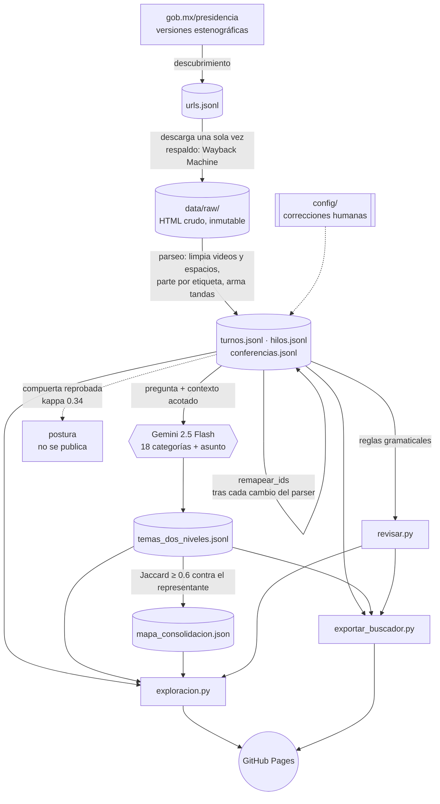
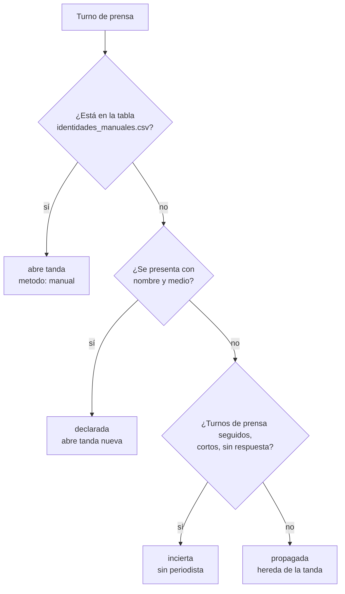
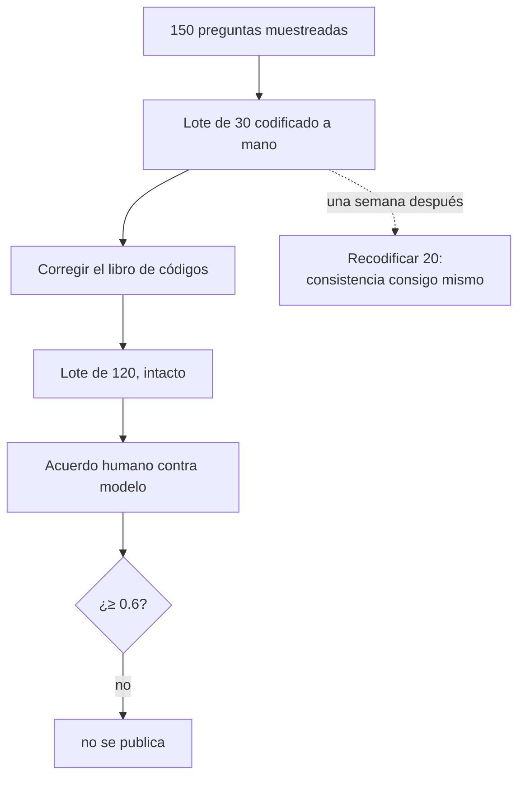

# Preguntas matutinas

Análisis de contenido de las versiones estenográficas de las conferencias de prensa matutinas de la
Presidencia de México, desde octubre de 2024. El proyecto convierte cada conferencia en datos —quién
habla, quién pregunta, de qué y qué le contestan— y los publica como un sitio consultable.

**Sitio:** https://jmtoral.github.io/preguntas_mananeras/ — metodología, exploración y buscador, con
datos al 30 de septiembre de 2026. El código del sitio vive en
[jmtoral/preguntas_mananeras](https://github.com/jmtoral/preguntas_mananeras); este repositorio es el
que lo produce.

> **Estado.** El corpus está descargado, leído, atribuido y clasificado por tema. **La postura de las
> preguntas (crítica, afín o neutral) no se publica**: el clasificador reprobó su validación contra
> codificación humana (kappa 0.34). Todo lo publicado son conteos descriptivos —quién recibe la palabra,
> de qué pregunta, cuánto le contestan—, con las limitaciones de la sección
> [Limitaciones conocidas](#limitaciones-conocidas).

---

## Contenido

1. [Las cifras](#las-cifras)
2. [Qué se publica](#qué-se-publica)
3. [El pipeline](#el-pipeline)
4. [Las unidades: turno, pregunta, tanda](#las-unidades-turno-pregunta-tanda)
5. [El dato](#el-dato)
6. [Cómo se sabe quién preguntó](#cómo-se-sabe-quién-preguntó)
7. [Canonización de nombres y medios](#canonización-de-nombres-y-medios)
8. [Clasificación temática](#clasificación-temática)
9. [«Revisar»: verbos de proceso en las respuestas](#revisar-verbos-de-proceso-en-las-respuestas)
10. [Postura y validación](#postura-y-validación)
11. [Contraste externo](#contraste-externo)
12. [Cómo correrlo](#cómo-correrlo)
13. [Archivos de configuración](#archivos-de-configuración)
14. [Trampas del formato](#trampas-del-formato)
15. [Limitaciones conocidas](#limitaciones-conocidas)
16. [Estructura del repositorio](#estructura-del-repositorio)
17. [Reproducir el ambiente](#reproducir-el-ambiente)
18. [Costos](#costos)
19. [Fuentes, licencia y advertencia](#fuentes-licencia-y-advertencia)

---

## Las cifras

| | Corpus completo | Corte publicado |
|---|---:|---:|
| Periodo | 3 oct 2024 – 5 oct 2026 | 3 oct 2024 – 30 sep 2026 |
| Conferencias | 488 | 485 |
| Conferencias con al menos una tanda | — | 482 |
| Turnos de habla | 68,781 | 68,345 |
| Turnos de prensa | 28,786 | 28,615 |
| Preguntas (turnos de prensa útiles dentro de una tanda) | 24,623 | 24,482 |
| Tandas | 2,906 | 2,894 |
| Periodistas identificados | 397 | 397 |
| Medios nombrados | — | 644 |
| Preguntas con tema | 23,694 | 23,560 (96%) |

El HTML crudo son 488 archivos, 80 MB. Las tandas identificadas por regla son 2,868 y las anotadas a mano
38 (ver [Cómo se sabe quién preguntó](#cómo-se-sabe-quién-preguntó)). Dentro de las tandas, la atribución de
cada pregunta es `declarada` 2,904, `propagada` 21,314 e `incierta` 405.

## Qué se publica

Tres páginas estáticas, sin servidor, en GitHub Pages:

| Página | Generador | Qué contiene |
|---|---|---|
| **Metodología** (`index.html`) | escrita a mano | qué se hizo, las unidades, cómo se guarda cada pregunta, el diagrama de la solución en Mermaid, las herramientas y lo que los datos no dicen |
| **Quién pregunta** (`exploracion.html`) | `scripts/exploracion.py` | mapa de calor por periodista y mes, concentración del micrófono, treemap de medios, temas por periodista, temas por mes, dendrograma de vocabulario, palabras de la presidenta, verbos de proceso, cruce con publicidad oficial y tabla completa |
| **Buscador** (`buscador.html`) | `scripts/exportar_buscador.py` | búsqueda por palabras, periodista, medio, tema y quién responde; el corpus viaja comprimido dentro de la página |
| **Caso Reyna Haydeé Ramírez** (`reyna.html`) | generado aparte | página fuera de las pestañas sobre la corrección de una periodista que recibe la palabra sin presentarse |

Las dos páginas generadas usan **el mismo corte y la misma canonización**: dan las mismas 24,482 preguntas.

## El pipeline



Reglas que atraviesan todas las etapas (vienen de `CLAUDE.md`):

- **El HTML crudo no se vuelve a descargar.** Se baja una vez y se conserva; el parser se reescribe, el corpus no.
- **Toda etapa es idempotente y reanudable**, con checkpoint y archivo de rechazos. El checkpoint hace `fsync` por renglón.
- **Nada se descarta en silencio.** Lo que no se puede procesar se escribe con su razón.
- **El modelo nunca ve el documento completo**: recibe una pregunta con su contexto inmediato.
- **Todo campo derivado lleva su procedencia**: `metodo` (`regex`, `llm`, `manual`), y el fragmento textual que lo justifica.
- **Nulo antes que inventado.** Si no se sabe quién preguntó, el campo va vacío.

## Las unidades: turno, pregunta, tanda

| Unidad | Qué es |
|---|---|
| **Turno de habla** | Cada bloque que empieza con una etiqueta en mayúsculas y dos puntos: `PREGUNTA:`, `PRESIDENTA DE MÉXICO, CLAUDIA SHEINBAUM PARDO:`. |
| **Turno de prensa** | Turno con etiqueta de prensa (`PREGUNTA`, `INTERLOCUTOR`, `INTERLOCUTORA`…). Incluye saludos, inaudibles y gritos del pleno. |
| **Pregunta** | Turno de prensa dentro de una tanda que no es ruido. **Un turno es una pregunta aunque traiga tres interrogaciones**, y también lo es una réplica de una palabra en un debate. |
| **Tanda** (en el código, *hilo*) | Una persona recibe el micrófono, se presenta y hace su serie de preguntas, con las respuestas intercaladas. Es la medida de **concesión de turnos**: cuántas veces le dieron la palabra. |
| **Intercambio** | Una pregunta más todo lo que le contestan hasta la siguiente pregunta. Es la unidad del buscador. |

«Fulano hizo 600 preguntas» y «a Fulano le dieron la palabra 60 veces» son afirmaciones distintas. El
ranking principal del sitio es por tandas.

## El dato

Todo vive en archivos **JSON Lines** en `data/interim/` (un registro por renglón), fáciles de versionar,
leer y auditar. `data/` está en `.gitignore`.

### `turnos.jsonl` — un renglón por turno

```json
{"conferencia_id": "2026-08-18", "orden": 17, "etiqueta": "PREGUNTA", "cargo": null,
 "hablante": null, "tipo": "prensa", "texto": "Muchas gracias, Presidenta. Nancy Rodríguez…",
 "apartes": []}
```

`tipo` es `prensa`, `funcionario` o `anonimo` (ruido de sala). `apartes` guarda lo dicho fuera de
micrófono entre rayas, para que no infle los conteos de palabras.

### `hilos.jsonl` — un renglón por tanda

```json
{"conferencia_id": "2026-08-18", "hilo": 0,
 "periodista": "Nancy Rodríguez", "medio": "Oro Sólido y de Empuje Migrante",
 "periodista_canonico": "Nancy Rodríguez", "metodo_identificacion": "regex",
 "turnos": [
  {"rol": "pregunta",  "quien": "Nancy Rodríguez", "atribucion": "declarada", "ruido": false, "orden": 17, "texto": "…"},
  {"rol": "respuesta", "quien": "CLAUDIA SHEINBAUM PARDO", "atribucion": "declarada", "ruido": false, "orden": 18, "texto": "…"},
  {"rol": "pregunta",  "quien": "Nancy Rodríguez", "atribucion": "propagada", "ruido": false, "orden": 19, "texto": "…"}
 ]}
```

`periodista` guarda lo que dice la estenográfica (lo verificable contra la fuente);
`periodista_canonico`, el nombre unificado. `metodo_identificacion` es `regex` o `manual`.

### `conferencias.jsonl` — un renglón por conferencia

`conferencia_id`, `tema_dia` (con su método y fragmento), `n_turnos`, `n_hilos`, `n_prensa`,
`n_preguntas_utiles`.

### `temas_dos_niveles.jsonl` — la clasificación de cada pregunta

```json
{"id_pregunta": "2026-08-18-h0-t17", "categoria": "salud_y_bienestar_social",
 "asunto": "bienestar de niños y regulación redes sociales", "metodo": "llm",
 "modelo": "gemini-2.5-flash", "fragmento": "Muchas gracias, Presidenta. Nancy Rodríguez…"}
```

### La llave de una pregunta

El id es `conferencia-hNN-tNN`, pero **el número de hilo se mueve** cada vez que el parser descubre una
tanda más. La llave estable es `(conferencia, orden)` (`estenograficas/ids.py`): el orden de un turno
dentro de su conferencia no cambia nunca. `scripts/remapear_ids.py` reencuentra cada clasificación por esa
llave después de reparsear, así que **ninguna clasificación pagada se pierde** al corregir el parser.

## Cómo se sabe quién preguntó

La estenográfica escribe `PREGUNTA:` para todos. El nombre solo aparece cuando la persona se presenta, y
lo hace una vez por tanda.



**Formas de presentación que reconoce el lector** (`parser.py`, `_IDENTIDAD`):

- **Con muletilla**: «Soy Aissa García, de Telesur», «Su servidor, Carlos Pozos…», «mi nombre es Viridiana Venta y soy del periódico Diario Cambio».
- **Sin muletilla, al inicio de oración, con coma**: «Dalila Escobar, de Proceso.»
- **Después de un saludo de una lista cerrada**: «Buenos días, Vicente Serrano, de Sin Censura TV.» La lista es cerrada a propósito: abrirla a cualquier coma convierte en periodista a «…Andrés Manuel López Beltrán, de encabezar una red de huachicol».
- **Sin conector**: «Eduardo Esquivel Ancona, Domo de Cristal.», con candados de forma (no abre con preposición, cargo ni tipo de medio; el medio empieza en mayúscula).
- **Sin coma**: «Nancy Flores de la revista Contralínea.» Solo se acepta **para nombres que en otra parte del corpus se presentaron completos** (segunda pasada en `parseo`). Sin ese candado daba diez instituciones («Ley General de…», «Estadio Ciudad de México») por doce periodistas.
- **Dentro de un inciso entre rayas o tras puntos suspensivos**: «—perdón, soy Yesenia Peralta, de Business Energy—».
- **Al despedirse**, en la cola del turno, con muletilla obligatoria.

El medio termina en punto, `…`, raya, `, así como`, `y <oficio>` o donde empieza a describirse
(`, que se transmite en…`, `, al que pertenecen…`, `, con 90 estaciones…`). Su tope es de 100 caracteres
y puede rebasar la ventana de 300 si la presentación empezó dentro de ella.

**Lo que ningún patrón alcanza va a `config/identidades_manuales.csv`** (38 filas): presentaciones sin
medio («Mi nombre es Christian Mart y soy creador de contenido»), fórmulas raras de corresponsales
extranjeros, y **personas que reciben la palabra sin presentarse nunca**. En ese último caso la prueba es
la presidenta llamándolas por su nombre («A ver, Reyna, te voy a dar la palabra»), y la frase queda en la
columna `nota`. Ver la página del caso en el sitio.

Cada cambio del lector se verifica igual: una foto de `identidad_declarada()` sobre los 28,786 turnos de
prensa antes y después. **Un cambio no entra si altera a la persona de una presentación que ya
funcionaba.**

## Canonización de nombres y medios

`src/estenograficas/canonizar.py`. Son dos problemas distintos.

**Nombres.** La fusión automática es tímida a propósito: une cuando una grafía es rara y la otra
frecuente (la firma de una errata). Cuando las dos son frecuentes no las toca y las reporta como
`DUDOSO`: pueden ser dos personas. La decisión es humana y vive en `config/canonico_periodistas.csv`;
escribir `variante == canonico` declara «ya lo revisé, son dos». Hay correcciones que ningún algoritmo ve:
la estenográfica escribe «Yareth Arciniega» y el nombre real es Yaneth.

**Medios.** `partir_medios()` separa una declaración en sus cabeceras: «Diario Basta, Tabasco Hoy,
Campeche Hoy y Quintana Roo Hoy, de Grupo Cantón» son cinco, y **cada una cuenta su turno**. Por eso la
suma por medio es mayor que el número de tandas y no es doble conteo: mide presencia de cabecera.
`clave()` compara ignorando acentos, artículo inicial y descriptor de soporte; lo que se **muestra** es la
grafía mejor capitalizada, no la más frecuente. Cabeceras de tres letras (`AFP`, `CNN`, `MVS`) son válidas;
una cabecera en minúscula se acepta solo si tiene un gemelo con mayúsculas en el corpus.

## Clasificación temática

Cada pregunta se clasificó con **Gemini 2.5 Flash**, temperatura 0, en dos niveles:

- **Categoría**: una de 18 cerradas, para tabular. La taxonomía se **indujo del corpus** (190 preguntas en texto libre destiladas a 18 categorías) y está en `data/interim/taxonomia_temas_candidata.json`.
- **Asunto**: una frase libre con el caso concreto, para seguir una historia.

| | categoría | | categoría |
|---|---|---|---|
| 1 | Seguridad y justicia | 10 | Trabajo y pensiones |
| 2 | Política y leyes | 11 | Educación y cultura |
| 3 | Corrupción y transparencia | 12 | Protestas y movilizaciones |
| 4 | Economía y finanzas públicas | 13 | Grupos vulnerables y derechos |
| 5 | Salud y programas sociales | 14 | Migración |
| 6 | Relaciones con otros países | 15 | Energía y combustibles |
| 7 | Obra pública y servicios | 16 | Prensa y libertad de expresión |
| 8 | Comercio e industria | 17 | Ciencia y tecnología |
| 9 | Medio ambiente y agua | 18 | Campo y alimentación |

**Consolidación de asuntos** (`scripts/consolidar_asuntos.py`): una variante se une a un grupo si comparte
al menos el 60% de su vocabulario (Jaccard) **con el representante del grupo**, no con cualquier miembro.
La primera versión usaba union-find y fusionaba en cadena: produjo un grupo de 204 variantes que pegaba
*regulación de redes sociales* con *reclutamiento del crimen organizado*, con similitud 0.00 entre los
extremos. El script verifica el invariante con un `assert` en cada corrida. Las etiquetas que no nombran
un tema («pregunta incompleta», «agradecimiento») van a un cubo propio. El asunto crudo nunca se
sobreescribe: el mapa vive aparte y se puede rehacer con otro umbral sin volver a clasificar.

**Callejón documentado:** agrupar las etiquetas con embeddings falló (el grupo mayor se tragaba entre 23% y
59%); inducir la taxonomía con el modelo sí funcionó.

## «Revisar»: verbos de proceso en las respuestas

`scripts/revisar.py`, a pedido de una periodista que cubre la fuente: ¿en cuántas respuestas la presidenta
dice que algo se va a revisar o está en proceso? Solo busca en **las palabras de ella**, no en las de otros
funcionarios del mismo intercambio. Sin modelo: reglas sobre las palabras que rodean al verbo.

- **Forma**: lo promete, ya está en proceso, hay que revisarlo, se lo encarga a alguien, ya se revisó, otro uso. Cada pregunta cuenta una vez, con su forma más comprometida.
- **Verbos**: «revisar» en cualquier forma; los demás (ver, analizar, investigar…) solo en gerundio con estar o seguir. Quedan fuera «vamos a ver» (muletilla) y «estamos trabajando» (demasiado genérico).
- **Sujeto**: ella o su gobierno, otra persona o institución, o sin sujeto.

Al corte: de 20,811 preguntas que contestó ella misma, en 1,780 usó alguno de los verbos y en 1,405 lo
dijo como promesa, encargo, necesidad o proceso en curso. **La precisión de las reglas no está medida.**

## Postura y validación

El objetivo original era clasificar cada pregunta como **crítica al gobierno, afín al gobierno o neutral**
(un cuarto valor, «crítica a un tercero», se fusionó con «afín»). El instructivo está en
`INSTRUCTIVO_CODIFICACION.md`. La regla operativa: la carga está en la premisa, no en el tema.

La calibración se diseñó antes de correr nada:



- **A ciegas en dos sentidos**: quien codifica no ve la salida del modelo, y la hoja no lleva periodista ni medio. Como muchas preguntas dicen su medio en el propio texto, esa oración se sustituye por `[identificación removida]` (`parser.redactar_identificacion`).
- **No se ajusta el prompt contra la validación.** El prompt se iteró sobre el lote de 30; la compuerta se aplicó al lote de 120 intacto.

**Resultado: la compuerta reprobó.** Contra los 120, 57% de acuerdo, **kappa 0.34**; contra los 30 donde
se iteró, 59% y 0.36 (ajustar no compró nada). El fallo está en una categoría: de lo que el humano marcó
«afín», el modelo acierta el 19% y manda el 56% a neutral. Y **el humano coincide consigo mismo en 57%,
kappa 0.35**: no es que el modelo no entienda la regla, es que «afín» no se puede leer en el texto de la
pregunta. Lo que sí funciona es distinguir preguntas con carga de preguntas sin ella (neutral se detecta
al 83%).

Existe una corrida de postura hasta agosto de 2026 (`data/outputs/postura_final.jsonl`) y una capa de
reglas sin validar (`scripts/postura_por_reglas.py`). **Ninguna se publica ni entra al sitio.**

## Contraste externo

La segmentación se cotejó contra conteos manuales de una persona que cubre la fuente. Ese material se usa
**solo como validación posterior, nunca como insumo**, y no se redistribuye.

- **Las tandas de los diez periodistas más frecuentes coincidieron diez de diez** en el periodo cotejado.
- Ese cotejo detectó dos errores que ninguna prueba propia veía: un tope de 70 caracteres en el medio que perdía presentaciones enteras (+596 preguntas a una sola persona) y que **un hilo solo nace donde hay autopresentación** (faltaban 148 tandas).
- Contra un conteo del primer semestre de 2026 faltaba un **14%** de las tandas. Esa medición es anterior a las correcciones de octubre de 2026 y no se ha repetido.

## Cómo correrlo

Python 3.11, desde la raíz del repositorio. En Windows conviene `PYTHONIOENCODING=utf-8`.

```bash
# 1. Descubrir URLs. Repasar el archivo COMPLETO: al entrar artículos nuevos la
#    paginación se recorre y un recorrido parcial pierde conferencias sin avisar.
PYTHONPATH=src python -c "from estenograficas.descubrimiento import main; raise SystemExit(main(refrescar=140))"

# 2. Descargar el HTML crudo (una sola vez por conferencia; abre un navegador real).
PYTHONPATH=src python -m estenograficas.descarga

# 3. Leer el corpus: turnos, tandas y conferencias. Reescribe todo en cada corrida.
PYTHONPATH=src python -m estenograficas.parseo

# 4. Después de CUALQUIER cambio del parser: reencontrar las clasificaciones ya pagadas.
PYTHONPATH=src python scripts/remapear_ids.py --dry
PYTHONPATH=src python scripts/remapear_ids.py

# 5. Clasificar temas (cuesta API). --dry anuncia cuántas faltan; vigilar el contador
#    contra esa cifra en los primeros minutos.
python scripts/clasificar_temas.py --dry
python scripts/clasificar_temas.py
python scripts/reconstruir_temas.py          # SIEMPRE al terminar
python scripts/consolidar_asuntos.py         # umbral 0.6 por omisión

# 6. Verbos de proceso (sin costo).
python scripts/revisar.py                    # → data/outputs/busquedas/sheinbaum_revisar.csv

# 7. Páginas del sitio, con el mismo corte.
python scripts/exploracion.py --hasta 2026-09-30        # → data/outputs/quien_pregunta.html
python scripts/exportar_buscador.py --hasta 2026-09-30  # → data/outputs/buscador.html
```

Para publicar: copiar `quien_pregunta.html` como `exploracion.html` y `buscador.html` al repositorio del
sitio, ajustar a mano las cifras de su `index.html` y hacer push.

**Búsqueda desde la línea de comandos** (`scripts/buscar.py`): frases sin acentos ni mayúsculas, ancladas a
palabra; `*` en un extremo suelta el anclaje (`amenaz*`); `|` da alternativas dentro de un requisito.

```bash
python scripts/buscar.py --frase "organismos autonomos" --frase INAI --nombre autonomos
python scripts/buscar.py --frase "revisa*|revise*|reviso" --en respuesta --responde sheinbaum
```

Salida en CSV y Markdown en `data/outputs/busquedas/`, con enlace a la estenográfica de cada resultado.

**Pruebas:** `python -m pytest -q` (179, contra conferencias de muestra en `fixtures/`).

## Archivos de configuración

Todos en `config/`. Las líneas que empiezan con `#` se quitan antes de leer; si falta una columna se
levanta excepción (un CSV con comentarios arriba se leía vacío **sin avisar**).

| Archivo | Para qué |
|---|---|
| `canonico_periodistas.csv` | `variante → canonico`. Erratas, fusiones decididas a mano y pares que se declaran dos personas. |
| `canonico_medios.csv` | Lo mismo para cabeceras. |
| `identidades_manuales.csv` | `conferencia_id, orden, periodista, medio, nota`. Presentaciones que el lector no alcanza; `nota` lleva la prueba textual. Manda sobre el regex. |
| `puente_medios.csv` | Pareo de medios con razones sociales del gasto federal en comunicación social (otro proyecto), con su nivel de confianza. Alimenta la sección de dinero. |

Las plantillas HTML de las páginas (`assets/exploracion_plantilla.html`, `assets/buscador_plantilla.html`)
están en `assets/`, que **no se versiona** porque también guarda material de terceros. Si se pierden, los
generadores no corren.

## Trampas del formato

Cada una costó trabajo encontrarla y **ninguna daba síntomas**: el pipeline corría, los archivos salían
bien formados y el dato estaba mal.

| Trampa | Efecto si no se atiende |
|---|---|
| Los testimonios en video traen hablantes etiquetados (`VOZ MUJER:`, `DERECHOHABIENTE:`) | Gente que no está en la conferencia entra al corpus |
| `INTERLOCUTOR` / `INTERLOCUTORA` fue la etiqueta de prensa hasta octubre de 2024 | 421 turnos de periodistas contados como declaraciones de gobierno |
| Etiqueta de prensa con paréntesis: `PREGUNTA (VIDEOLLAMADA)` | 36 turnos de prensa contados como de gobierno |
| El orden de la etiqueta se invierte: `CARGO, NOMBRE` en 2026, `NOMBRE, CARGO` en 2024 | Cargo y nombre intercambiados en un tercio de los funcionarios |
| Etiqueta seguida de espacio duro (`\xa0`) | El turno se funde con el anterior y queda atribuido a la presidenta, sin error |
| Desde 2025 el CMS envuelve los párrafos en `<div>` | La conferencia entera se lee como un párrafo: un turno, cero tandas, cero errores |
| `—000—` cierra el boletín y tiene la forma de un aparte | Se le atribuye a la presidenta |
| `INTERVENCIÓN:` es ruido de sala, no un hablante | Parte tandas en dos en silencio |
| Turnos `PREGUNTA:` seguidos y cortos son gente distinta gritando | Se le atribuyen a un periodista frases que no dijo (`incierta`) |
| `Nombre, de Medio` sin anclar a inicio de oración | Encuentra 6 periodistas donde hay 4 (`…López Beltrán, de encabezar una red`) |
| El medio pasa de 70 caracteres al enumerar cabeceras | Presentaciones perdidas; +596 preguntas a una persona al corregirlo |
| El medio se describe sin cerrar en punto (`…, que se transmite en Chihuahua…`) | Una periodista no existía en los conteos (10 presentaciones perdidas) |
| Presentación tras un saludo, sin coma, en un inciso o tras `…` | 87 tandas recuperadas en octubre de 2026 |
| **Un hilo solo nace donde hay autopresentación** | Quien recibe la palabra sin presentarse no tiene tanda y sus preguntas se le cargan al anterior: error doble, sin síntomas |
| **Reparsear renumera las tandas** | Las clasificaciones pagadas quedan huérfanas; `remapear_ids.py` las recupera |
| El archivo de gob.mx es paginado y se recorre al publicar | Un descubrimiento parcial dejó agosto de 2026 con 3 conferencias en vez de 21 |
| Un CSV de configuración con comentarios `#` arriba | Se lee vacío y las correcciones humanas dejan de aplicarse sin avisar |
| gob.mx responde un reto anti-bot a clientes sin JavaScript | La descarga necesita un navegador real y un escritorio; no corre en servidor |

Y una que se intentó arreglar y hubo que revertir: tratar `(PROYECCIÓN DE VIDEO)` como apertura de bloque
borraba 787 turnos, 239 de prensa, porque no tiene cierre propio.

## Limitaciones conocidas

- **Mide concesión de turnos, no asistencia.** La estenográfica registra a quien habló; de quien fue al salón y no recibió la palabra no queda una línea.
- **Quién habla no es aleatorio.** La presidenta elige y lo dice en voz alta. Cualquier conclusión sobre «la prensa» tiene que discutir selección antes que deferencia.
- **Faltan tandas de quien no se presenta.** Se recuperaron las que deja ver la estenográfica, pero el hueco no es aleatorio: subcuenta a quien acostumbra no decir su nombre y sobrecuenta al periodista anterior.
- **Una tanda dura hasta la siguiente presentación.** Si después de alguien habló otra persona sin presentarse, esos turnos quedan en la tanda equivocada.
- **«Pregunta» cuenta turnos, no preguntas distintas.** En un debate de ida y vuelta cada réplica suma. Una persona con pocas tandas muy largas puede encabezar el conteo de preguntas sin que le den más veces la palabra; por eso el ranking principal es por tandas.
- **Qué cuenta como pregunta cambia el total.** Se filtran saludos, inaudibles, interjecciones e `INTERVENCIÓN:`; con y sin filtro el total de los diez más frecuentes varía ±6%. Cualquier conteo independiente dará otro número por esta razón y no por un error.
- **Los asuntos casi no cruzan conferencias**: el 89% aparece en una sola. Sirven para ver de qué habla cada quien, no para medir cuánto dura una historia.
- **«Prensa y libertad de expresión» no es comparable en el tiempo**: también recoge turnos sin contenido, en cantidades que cambiaron entre corridas de clasificación.
- **4,122 preguntas tienen dos clasificaciones de tema** por una reclasificación de septiembre; todo lo publicado usa la última. Falta decidir cuál gana y deduplicar.
- **929 preguntas no tienen tema** en el corpus completo: rechazadas por el clasificador o entradas al corpus después de la última corrida.
- **La precisión de las reglas de «revisar» no está medida.**

## Estructura del repositorio

```
src/estenograficas/
  config.py              rutas y secretos; ninguna ruta absoluta escrita a mano
  checkpoint.py          reanudación con fsync por renglón y archivo de rechazos
  descubrimiento.py      URLs de las versiones estenográficas
  descarga.py            HTML crudo, con respaldo en Wayback
  parser.py              texto → turnos → tandas; identidad y redacción a ciegas
  parseo.py              lectura masiva del corpus, identidades manuales, canonización
  canonizar.py           nombres y medios
  ids.py                 llave estable (conferencia, orden)
  temas.py               etiqueta temática libre (primera versión)
  temas_dos_niveles.py   categoría + asunto, consolidación
  postura.py             clasificación de postura (no se publica)
scripts/
  remapear_ids.py        recupera clasificaciones tras reparsear
  clasificar_temas.py    clasificación temática, reanudable
  reconstruir_temas.py   reescribe el JSONL desde el checkpoint
  consolidar_asuntos.py  mapa de asuntos canónicos
  buscar.py              búsqueda por palabras, CLI
  revisar.py             verbos de proceso en las respuestas
  exploracion.py         página «Quién pregunta»
  exportar_buscador.py   página del buscador
  muestrear_oro.py       muestra de oro para la codificación a mano
  clasificar_postura.py  postura con el modelo (no se publica)
  postura_por_reglas.py  capa de reglas sin validar (no se publica)
  recodificar_lote1.py   recodificación para consistencia intra-codificador
config/                  correcciones humanas (ver arriba)
tests/                   179 pruebas
fixtures/                5 conferencias de muestra, versionadas
CLAUDE.md                reglas permanentes del proyecto
HANDOFF.md               bitácora entre sesiones: qué pasó, no qué se pretendía
INSTRUCTIVO_CODIFICACION.md
data/                    en .gitignore: raw/, interim/, gold/, outputs/, checkpoints/
```

## Reproducir el ambiente

```bash
conda env create -f environment.yml
conda activate votaciones_corte
pip install -e .
cp .env.example .env        # y poner la API key de Gemini (solo para clasificar)
python -m pytest -q
```

`environment.yml` es la exportación de un ambiente compartido con otro proyecto: funciona, pero lista más
de lo necesario. La descarga del corpus tarda unos 15 minutos y abre una ventana de navegador.

## Costos

Medidos con la API, no estimados:

| Etapa | Costo |
|---|---|
| Clasificación temática inicial, ~12 mil preguntas | ~$5 USD |
| Reclasificaciones tras correcciones del parser | $0.58 y $0.48 |
| Postura, tres corridas sobre el corpus | ~$18 USD |

Más de la mitad del costo de entrada es texto repetido en cada llamada (taxonomía, vocabulario de
asuntos). Ahí está el ahorro si importa, no en cambiar de modelo. `remapear_ids.py` existe para no volver
a pagar lo ya clasificado: el 2026-10-06 un filtro por id exacto repagó 2,519 clasificaciones ($0.34).

## Fuentes, licencia y advertencia

Las versiones estenográficas son documentos públicos de la Presidencia de la República, publicados en
[gob.mx/presidencia](https://www.gob.mx/presidencia). Este repositorio contiene el código y cinco
conferencias de muestra; el corpus completo no se redistribuye y se reconstruye corriendo el pipeline. La
fuente citable de cualquier dato es la versión estenográfica, no este repositorio.

Este trabajo **mide y describe, no adjetiva**. Las categorías se definen para que alguien con la posición
política contraria las aplique igual. Ningún resultado sobre postura, confrontación o deferencia se ha
publicado, y cualquier afirmación en ese sentido atribuida a este proyecto es incorrecta.
